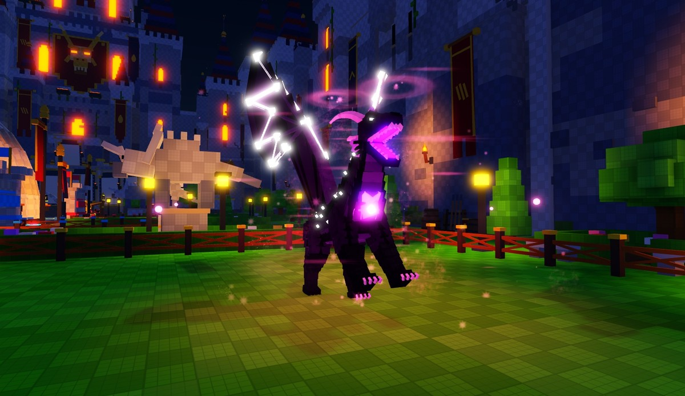
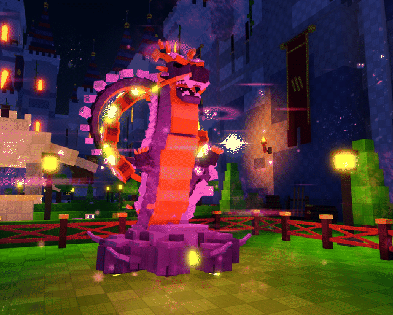
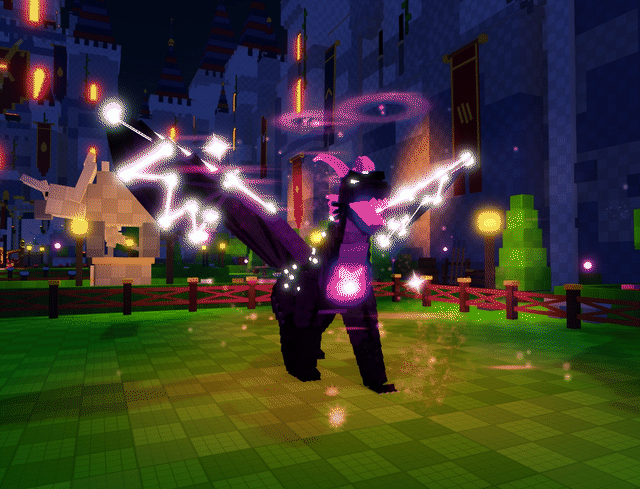
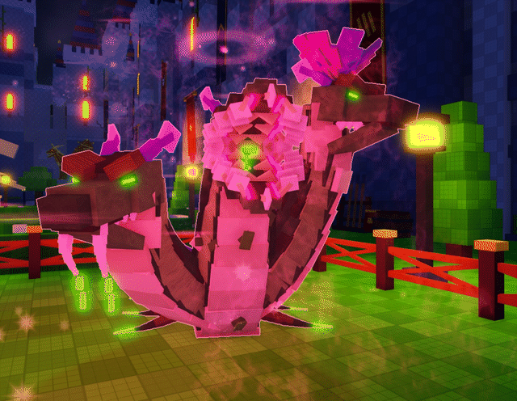
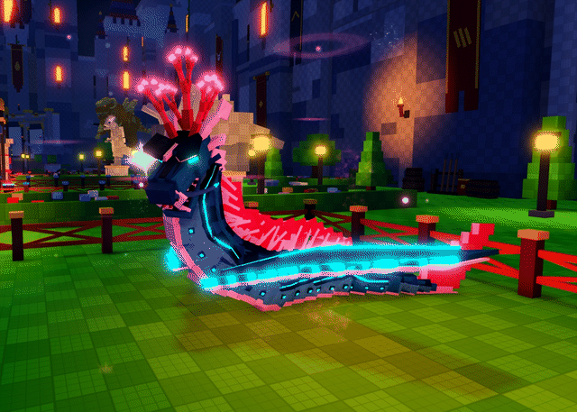

# Steal a Kaiju [WIP]

A Roblox game about stealing kaiju eggs from guarded nests, hatching them into monsters that earn you money, and stealing from other players' pens.



Written in Luau in Roblox Studio: about 66,000 lines across 200 scripts. This repo holds the game's code. The UI (`StarterGui`) is left out, and so are the place file, models and assets.

## The game

- **The run:** one long canyon heads out from the hub across seven biomes: Pebble Plains, Lava Lagoon, Frostfang Peaks, Venom Jungle, Sunken Abyss, Storm Spires and Cosmic Rift.
- **Eggs and guardians:** each biome has a nest of eggs guarded by a sleeping boss kaiju. Take an egg and the guardian wakes and chases you all the way back to the safe zone.
- **Hatching:** eggs come in seven rarities and four sizes. A bigger egg hatches a bigger kaiju that earns more.
- **Your kaiju:** 43 species roam your pen and pay out every second. Feed them to level them up, or sell them.
- **Stealing:** hold E on someone else's egg or kaiju to steal it. Defenders knock thieves down with a bat, and bases can be locked for a short time.
- **Getting faster:** personal treadmills raise your Speed, and trails come with their own auras.
- **The Kaiju Citadel:** the hub, with a fortress, a market and champion statues of the top players.

## The animation engine

Every kaiju, guardian and shopkeeper is animated by one client-side engine, `ReplicatedStorage/KaijuAnimation` (about 6,400 lines). Each model is a few hundred to over a thousand anchored bricks. The engine turns them into a living rig on each player's machine, without the server or the saved models ever changing.

| Raijin Wyrm: drumroll | Astral Wyrm: wing spread |
|---|---|
|  |  |
| **Hydravine: squabble** | **Tidewyrm: wing ripple** |
|  |  |


How it works:

- **Rigs built at runtime (`Rig`).** A model's body groups (sub-models tagged with a `Joint`) are read once and cached by species. The engine then adds invisible pivot parts, a `Motor6D` chain (root, body, limbs), and welds every brick to its pivot. The build is spread over frames under a per-frame time budget. The root stays anchored exactly where the server put it.
- **Layered motion (`Motion`).** Breathing scaled to body size, weight shifts, head glances, the species' own idle layers (tails, ears, frills, wings, tentacles), the current mood, then the current action. Everything is solved as exact damped springs that lag behind their parent's movement, so tails and necks follow through and settle.
- **Grounded feet.** A planted limb pivots about its foot, so feet don't slide while the body moves. Walking uses per-species gaits (biped, knuckle-walk, trot, amble, crawl, sideways scuttle, six-legged, hop, slither).
- **Data-driven actions (`Actions`).** Each signature move is a keyframe table in `Config`: channels per joint (pitch, yaw, roll, offset, glow, foot plant), oscillators, mirroring, delays along a chain, and timed sound and particle events. A variant can extend another, so 43 species share about 40 moves.
- **States read from game state, never written (`States`).** Owner nearby, stranger nearby, eating, being stolen, carried in panic over a thief's head, asleep at night, a guardian waking, chasing and carrying an egg home. A new state is one `States.Register` call.
- **Performance.** Every creature is sorted into full, reduced, far or off by distance and screen visibility, under caps per device. Walking roots move together in one `BulkMoveTo` call each frame. The neon glow is only recoloured when the change would actually be visible. A debug panel shows the time spent per frame on posing, effects and walking.

## Layout

Folders follow Roblox's services, Rojo-style:

| File | What it is |
|---|---|
| `Name.lua` | ModuleScript |
| `Name.server.lua` | Script |
| `Name.client.lua` | LocalScript |
| `Name/init*.lua` | a script that has child modules |

```
src/
  ReplicatedStorage/KaijuAnimation/   the animation engine (client side)
  ReplicatedStorage/Shared/           config tables and shared utilities (both sides)
  ServerScriptService/
    Bootstrap.server.lua              starts every service
    Services/                         gameplay services (data, eggs, guardians, hatching, economy, stealing, ...)
    Lib/                              model builders and helpers (ProfileStore is vendored)
  ServerStorage/Tools/                edit-time builders: run from the Studio command bar, never at runtime
  StarterPlayer/StarterPlayerScripts/ client effects, input and the animation engine's entry point
```

## Other interesting parts

- **`Tools/KaijuSculpt` + `Tools/KaijuSculptSpecs`:** procedural "sculpted voxel" monsters.
  - Each species is a `Build(K)` function that places blocks, tubes with shingled tiles, ridges, horns and claws onto a rig.
  - The builder merges and textures the result into a model the animation engine can rig.
- **`Tools/CanyonBuilder`:** builds each biome's canyon: terrain, rugged cliffs, landmarks and a gate per biome, from one shared template (`NewBiome`) plus a theme module per biome. Props in the run are left pass-through so nobody snags on scenery while running home.
- **`Tools/CitadelBuilder`:** the hub fortress, built procedurally around the plots and market without touching anything gameplay scripts reference.
- **`Services/GuardianService`:** every thief gets a personal guardian. It paces itself to the thief's speed, gives a head start, fetches dropped eggs and carries them home in its jaws or arms.
- **`Services/StealService`:** server-timed steals. The server checks the steal at the start, while the player holds E, and at delivery, and anti-teleport checks send stolen items home.
- **`Gameplay/WorldCuller` + `Tools/MapOptimizer`:** the client unloads distant map detail, and hidden stud textures and tiny shadow casters are stripped at build time.

## Credits

- **Built by** Andy Nguyen with Claude (Anthropic's AI) as pair programmer. Those commits carry a `Co-Authored-By` trailer.
- **Teammates:** they built the UI, which isn't in this repo, and the weather, mutation, day/night, luck, rewards, pets, leaderboard, AFK and admin systems (one commit authored to them). They have also contributed later changes, such as the bat, auras and sound, which were committed from Andy's account as they landed in the shared Studio place.
- **ProfileStore** is by loleris (MAD STUDIO).

## History

Development happens in Roblox Studio, and this repo was set up partway through.

The commits before it existed were rebuilt from the development session logs and the versioned backups kept in the place. Each one is dated to when that change was made. A few changes whose exact order couldn't be recovered are grouped into neighbouring commits.

From the repo's creation on, every change is committed as it's made.
